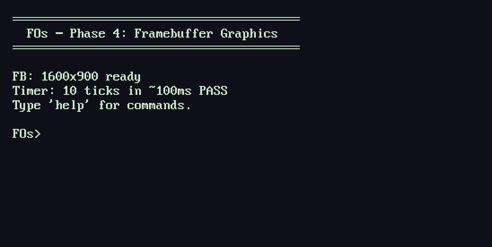
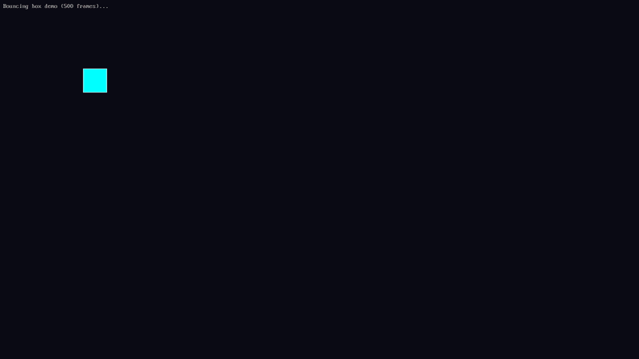
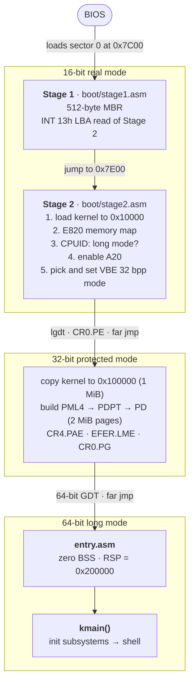
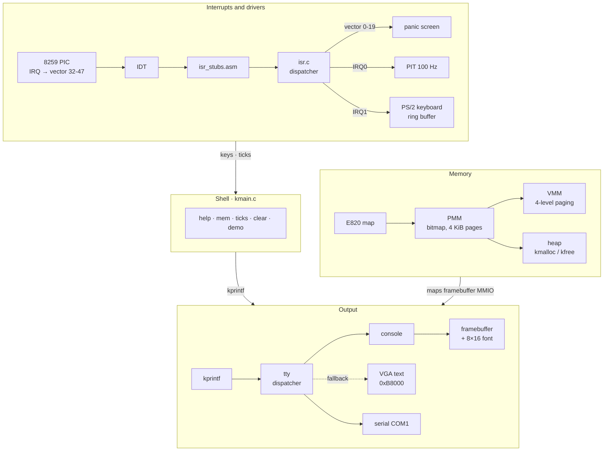
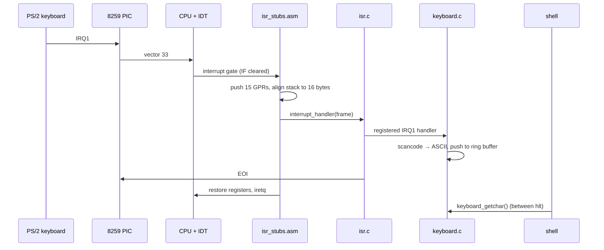

<div align="center">

# FOs

**A from-scratch x86-64 operating system, built phase by phase with one goal: run DOOM.**


</div>

FOs boots from a raw disk image with **no GRUB, no UEFI, no libc and no external code**. The
two-stage bootloader, the switch from 16-bit real mode to 64-bit long mode, memory management,
interrupts, drivers and the pixel console are all written by hand in C and NASM.
That is about 2,900 lines of code, plus a 4 KB bitmap font, and the kernel binary is 21 KB.

<table>
  <tr>
    <td align="center" width="58%"></td>
    <td align="center" width="42%"></td>
  </tr>
  <tr>
    <td align="center"><sub>Interactive shell on the framebuffer console (real QEMU capture)</sub></td>
    <td align="center"><sub><code>demo</code>: animation driven by the 100 Hz timer</sub></td>
  </tr>
</table>

---

## What works today

| Area | What FOs does |
| --- | --- |
| **Boot** | Custom 2-stage BIOS bootloader: MBR → real mode → protected mode → long mode, with serial breadcrumbs at every step |
| **Memory** | E820 memory detection, bitmap physical page allocator, 4-level paging (2 MiB identity map + 4 KiB on-demand mappings), `kmalloc`/`kfree` heap that coalesces free blocks and grows on demand |
| **Interrupts** | 256-entry IDT, remapped 8259 PIC, assembly stubs for all 20 exceptions and 16 IRQs, spurious IRQ detection, drivers register their own handlers |
| **Crash handling** | CPU exceptions print a kernel panic screen (vector, error code, RIP, RSP, registers, CR2 on page faults) instead of silently triple faulting |
| **Drivers** | PIT timer at 100 Hz, PS/2 keyboard (scancode set 1, Shift and Caps Lock, ring buffer), COM1 serial, VGA text mode |
| **Graphics** | Searches every VBE mode for the highest-resolution 32 bpp one (1600×900 on QEMU) and draws pixels, rectangles and an 8×16 CP437 font; falls back to VGA text mode if VBE fails |
| **Shell** | `help`, `mem`, `ticks`, `clear`, `demo` |

## Roadmap

| Phase | Goal | Status |
| :---: | --- | :---: |
| 1 | Boot in QEMU with a custom bootloader and print text | ✅ |
| 2 | Physical memory, paging and a kernel heap | ✅ |
| 3 | Interrupts, keyboard, timer and an interactive shell | ✅ |
| 4 | Framebuffer graphics and a pixel console | ✅ |
| 5 | Userspace: ELF loader, syscalls, scheduler | 🔜 Next |
| 6 | FAT32 filesystem: read files from disk | ⬜ |
| 7 | **DOOM runs** ([doomgeneric](https://github.com/ozkl/doomgeneric)) | ⬜ |

Each finished phase has a design write-up covering the decisions taken and the bugs hit along the
way: [Phase 1](docs/PHASE1.md) · [Phase 2](docs/PHASE2.md) · [Phase 3](docs/PHASE3.md) · [Phase 4](docs/PHASE4.md).

---

## Architecture

### Boot chain

The BIOS only loads 512 bytes and starts the CPU in 16-bit mode. The bootloader climbs to 64-bit
mode one step at a time:



Stage 1 and Stage 2 write `1`, `2`, `P` and `L` to the serial port as they go, so a hang shows
exactly which step failed.

### Kernel components



### Life of a key press



### Physical memory map

| Address | Contents |
| --- | --- |
| `0x001000` to `0x003FFF` | Temporary boot page tables (PML4, PDPT, PD) |
| `0x004FF8` · `0x005000` | E820 entry count · E820 entries |
| `0x005FF0` · `0x006000` | VBE success magic (`0x1EAF`) · VBE mode info for the kernel |
| `0x007C00` | Stage 1 (MBR) |
| `0x007E00` to `0x009DFF` | Stage 2 (8 KiB) |
| `0x010000` to `0x01FFFF` | Kernel temporary load (up to 64 KiB) |
| `0x0B8000` | VGA text buffer (fallback output) |
| `0x100000` | **Kernel image** (`.text` · `.rodata` · `.data` · `.bss`), then PMM-allocated pages |
| `0x200000` | Kernel stack top (grows down) |
| `0x300000` | PMM bitmap |
| `0x400000` + | Kernel heap (256 KiB initial, grows on demand) |
| `0xFD000000` | Linear framebuffer (PCI MMIO, mapped on demand by `fb_init`) |

Everything is identity-mapped (virtual address = physical address). A higher-half kernel and
separate address spaces arrive with userspace in Phase 5.

### Initialisation order

The order matters: enabling interrupts before the IDT and PIC are ready causes a triple fault.

```text
serial → VGA text → PMM → VMM → heap → PIC remap (all masked) → IDT
       → PIT 100 Hz → keyboard → unmask IRQ0/IRQ1 → sti
       → VBE framebuffer + console → boot screen → shell
```

---

## Build and run

You need an **x86-64 Linux** host. FOs is built with the system GCC in freestanding mode, so no
cross-compiler is required.

```sh
# Arch
sudo pacman -S base-devel nasm qemu-system-x86
# Debian / Ubuntu
sudo apt install build-essential nasm qemu-system-x86

make        # builds fos.img (stage1 + stage2 + kernel)
make run    # boots it in QEMU, serial log on your terminal
```

| Target | What it does |
| --- | --- |
| `make run` | QEMU window + serial output on stdio |
| `make run-serial` | Headless: serial console only |
| `make run-debug` | Logs interrupts and CPU resets (useful for triple faults) |
| `make debug` | Starts paused and waits for GDB on `:1234` |
| `make clean` | Removes all build artefacts |

<details>
<summary>Serial output of a successful boot</summary>

```text
12PL
========================================
  FOs - Phase 4: Framebuffer Graphics
========================================

E820 Memory Map (7 entries):
  0x0 - 0x9fc00  Usable
  0x9fc00 - 0xa0000  Reserved
  0xf0000 - 0x100000  Reserved
  0x100000 - 0x7fe0000  Usable
  0x7fe0000 - 0x8000000  Reserved
  0xfffc0000 - 0x100000000  Reserved
  0xfd00000000 - 0x10000000000  Reserved

PMM: 126 MB usable (32472 pages free, 32736 total)
VMM: identity-mapped 127 MB using 2MB huge pages
Heap: 256 KB at 0x400000

FB: 1600x900 32bpp pitch=6400 phys=0xfd000000
========================================
  FOs - Phase 4: Framebuffer Graphics
========================================

FB: 1600x900 ready
Timer: 10 ticks in ~100ms PASS
Type 'help' for commands.

FOs> help
Commands: help, ticks, mem, clear, demo
```

</details>

Tested with GCC 16.2, NASM 2.16 and QEMU 11.1. The build uses `-Werror`, and `make` stops if the
kernel outgrows the 64 KiB the bootloader can load.

---

## Engineering notes

A few of the problems found along the way. The phase write-ups cover them in detail.

- **`-O2` triple fault in the first `kmalloc`.** GCC assumes SSE2 on x86-64 and used `movaps`
  for struct copies, but the kernel never enables SSE, so the CPU raised #UD. The fix was to build
  with `-mno-sse -mno-sse2 -mno-mmx`, as Linux does. ([Phase 2](docs/PHASE2.md))
- **Bitmap sized for 1 TiB of RAM.** E820 reports PCI MMIO regions up to 1 TiB. Sizing the
  bitmap from them made it larger than the memory mapped at boot. Only usable regions count
  now. ([Phase 2](docs/PHASE2.md))
- **Heap corruption from unsigned underflow** when splitting a block that was too small, fixed
  with a guard before subtracting. ([Phase 2](docs/PHASE2.md))
- **No 32 bpp mode on QEMU's standard VBE list.** The standard VESA mode numbers are 24 bpp there,
  so Stage 2 searches the whole mode list for the best 32 bpp mode with a linear framebuffer.
  ([Phase 4](docs/PHASE4.md))
- **`-mno-red-zone`.** Interrupts would overwrite the 128 bytes below RSP that the System V ABI
  lets functions use. ([Phase 1](docs/PHASE1.md))

**Current limitations:** legacy BIOS boot only (no UEFI), a single CPU core, PIC and PIT instead of
APIC and HPET, one identity-mapped address space, and so far tested only in QEMU.

---

## Project layout

```text
FOs/
├── boot/
│   ├── stage1.asm        # MBR: loads Stage 2 (512 bytes, 0xAA55 signature)
│   └── stage2.asm        # E820, CPUID, A20, VBE, real → protected → long mode
├── kernel/
│   ├── entry.asm         # _start: zero BSS, set stack, call kmain
│   ├── kmain.c           # init sequence, boot screen, shell
│   ├── pmm.c · vmm.c · heap.c          # memory management
│   ├── idt.c · isr.c · isr_stubs.asm   # interrupts and exceptions
│   ├── pic.c · pit.c · keyboard.c      # interrupt controller, timer, keyboard
│   ├── framebuffer.c · console.c · font.c · tty.c   # graphics and text output
│   └── serial.c · kprintf.c · string.c # debugging output, printf, libc subset
├── docs/                 # PHASE1-4 design notes, README media
├── linker.ld             # kernel linked at 0x100000, entry first
└── Makefile              # build, disk image layout and QEMU targets
```

## References

- [OSDev Wiki](https://wiki.osdev.org): main reference
- [Intel® 64 and IA-32 Architectures Software Developer's Manuals](https://www.intel.com/content/www/us/en/developer/articles/technical/intel-sdm.html)
- [Writing an OS in Rust](https://os.phil-opp.com): the concepts carry over to C
- [xv6-riscv](https://github.com/mit-pdos/xv6-riscv): MIT teaching OS
- [doomgeneric](https://github.com/ozkl/doomgeneric): the portable DOOM port FOs is aiming for

## License

[MIT](LICENSE)
